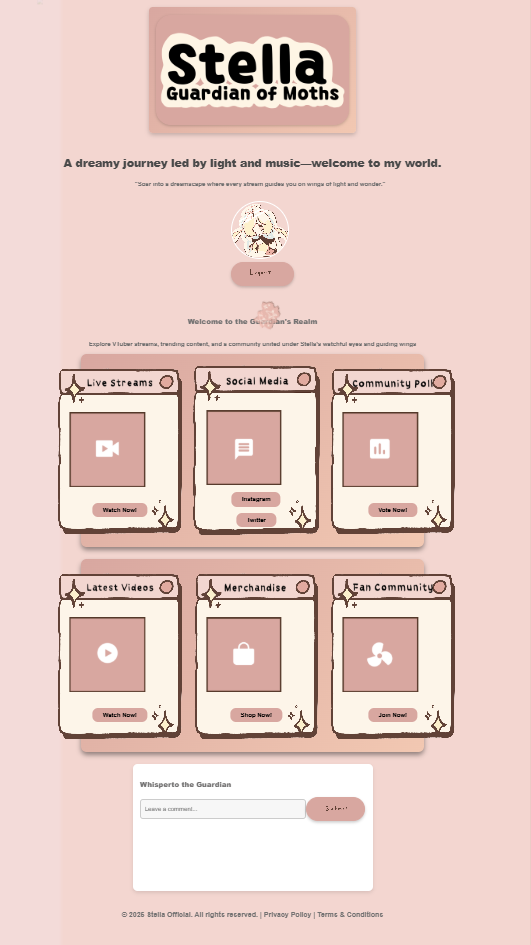
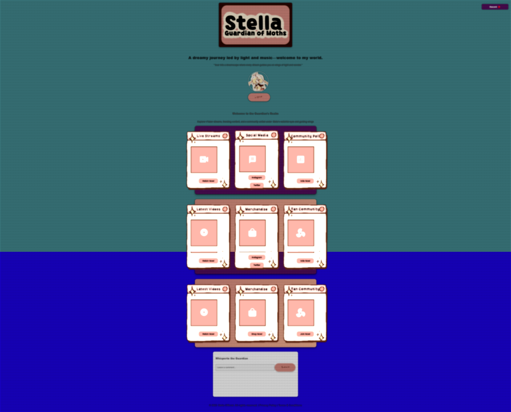

# 🦋 Project Coward: Interactive ARG Ecosystem
**Live Interactive Hub:** [👉 Enter VTuber Nexus](https://marquis09.github.io/vtuber/)

An immersive, multi-platform web hub engineered for a psychological horror Alternate Reality Game (ARG). The platform acts as a narrative web, utilizing responsive layouts, frontend authentication barriers, and dynamic state-mutation scripts to bridge local interface mechanics with active live networks across Twitter, Reddit, and Instagram.

---

## 🕹️ Architecture Showcase & State Mutation

### The Cozy Hub (Pre-Glitch UI)

*The clean, welcoming baseline layout designed to mimic an authentic, operational live-streamer portal.*

### The Glitch Event (Post-Interaction UI)

*The system post-trigger: utilizing client-side JavaScript DOM overrides, corrupted image swaps, and dynamic style degradation to simulate total system infection.*

---

## 🛠️ Core Engineering & Mechanics
- **Dual-State Engine:** Developed a client-side state controller that morphs the visual identity of the page instantly upon user interaction triggers.
- **The Portal Gate:** Built a hardcoded administrative authentication panel (`admin` / `password123`) acting as a cryptographic progression gate for players hunting clues across external social nodes.
- **Cross-Origin Synergy:** Coordinated layout parameters alongside a 2D lead artist and writing team to assemble multimedia fragments into an intuitive, responsive grid.

---

## 🚨 Production Pivot: Algorithm Adaptability
* **The Challenge:** Immediately prior to launch, our custom character bot feed was shadowbanned by external platform safety algorithms due to fictional high-velocity activity, threatening to sever our central progression loop.
* **The Intervention:** I rapidly re-engineered the website routing matrix, redirecting outbound channel weight toward active alternative nodes (Reddit and Instagram). I baked custom simulated fallbacks into the code to gracefully handle algorithmically restricted dead-ends.
* **The Outcome:** The deployment architecture was stabilized with zero launch delay, maintaining full player immersion and preserving the cross-origin user experience.

---

## 📐 Project Logistics
- **My Role:** Lead Web & UI Developer
- **Team Scale:** 6-Person Multidisciplinary Studio (Engineering, Visual Arts, Narrative, PR)
- **Framework Stack:** Pure Semantic HTML5, CSS3 Component Layouts, Dynamic JavaScript (ES6+ DOM Mutation)
